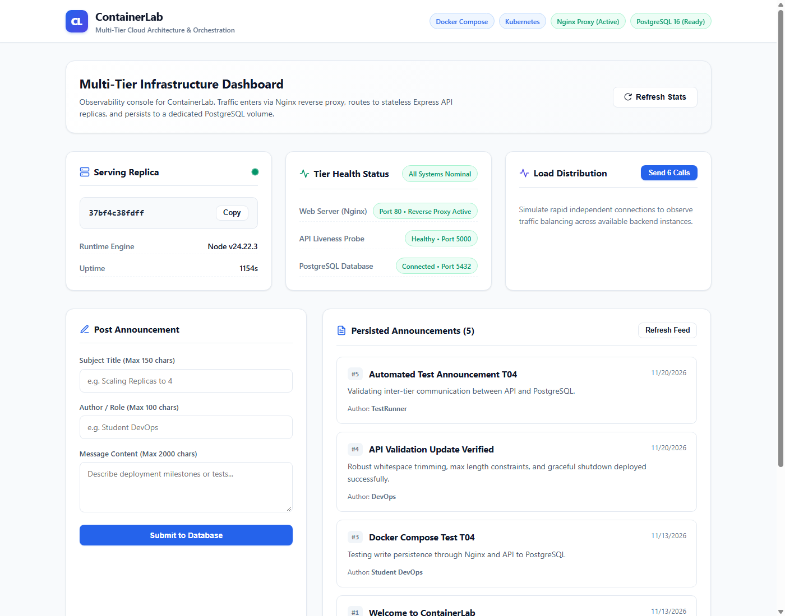
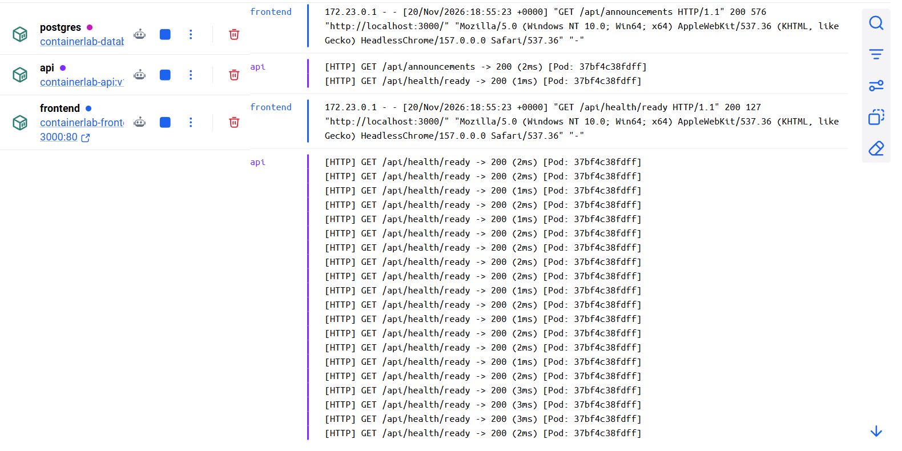
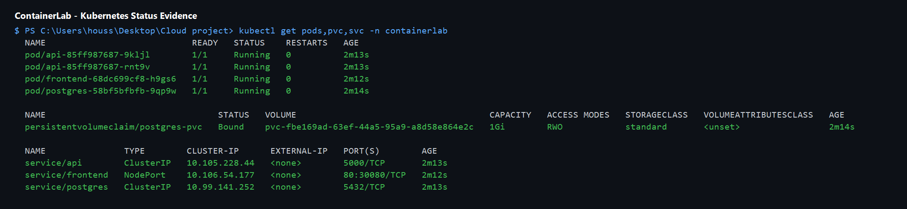

# ContainerLab: Secure & Scalable Multi-Tier Cloud Application
### *From Local Docker Compose to Kubernetes Cluster Orchestration*

[](#-academic-context--course-rubric-alignment-20-pts)
[-blueviolet.svg)](#-academic-context--course-rubric-alignment-20-pts)
[](#-stage-1-local-orchestration-with-docker-compose-3-pts)
[](#-stage-2-cluster-orchestration-with-kubernetes-on-minikube-5-pts)
[](application/backend/)
[](application/frontend/)
[](application/database/)
[](#-automated-verification-suite-tests-t01--t11-3-pts) [](#-automated-verification-suite-tests-t01--t11-3-pts)

### Project Identity

| Field | Information |
| :--- | :--- |
| **Students** | Houssem Sassi and Nour El Houde Jaziri |
| **University** | ESSTHS |
| **Course** | Virtualisation et Cloud Computing |
| **Group** | TD1 / TP1 |
| **Topic** | Proposition 2 - Conteneurisation et Orchestration locale vs Cloud |
| **Academic Year** | 2025-2026 |
| **Instructor** | Imen Nasr |

---

## 📌 Executive Summary

**ContainerLab** is an academic implementation of a resilient, containerized multi-tier web application designed to fulfill **Proposition 2 (Conteneurisation et Orchestration locale vs Cloud)** for the *Virtualisation et Cloud Computing* course.

The project demonstrates the practical and theoretical progression of modern cloud-native systems across two operational stages:
1. **Local Multi-Container Composition (Docker & Docker Compose)**: Implements dual-network DMZ segmentation, synchronized health-check startup dependencies, non-root container security, and named volume persistence.
2. **Cluster Orchestration (Kubernetes on Minikube)**: Implements declarative numbered manifests within a dedicated namespace, dynamic Persistent Volume provisioning (`standard` StorageClass), decoupled Liveness/Readiness probes, horizontal replica scaling (2 to 4 pods), load-balanced ClusterIP/NodePort routing, and autonomous pod self-healing.

## ⚡ Professor Quick Start

**Prerequisites:** Docker Desktop with Linux containers, PowerShell 7+, and (for the Kubernetes path) Minikube and `kubectl`.

```powershell
# Docker Compose: build, start, and open the dashboard
.\scripts\run-compose.ps1
# Open http://localhost:3000
docker compose ps
```

For the Kubernetes demonstration, start Minikube, load the local images, and deploy the manifests:

```powershell
minikube start --driver=docker
.\scripts\load-images.ps1
.\scripts\deploy-k8s.ps1
minikube service frontend --url -n containerlab
```

> [!IMPORTANT]
> The values in `.env.example` are **local classroom-demo credentials only**. Replace them with unique secrets for any environment outside a local demonstration; never commit real credentials.

> [!WARNING]
> `./scripts/run-tests.ps1` intentionally changes infrastructure: it restarts PostgreSQL, scales and deletes Kubernetes Pods, and its final test removes the `containerlab` namespace. Run it only against a dedicated local test environment. Use `./scripts/run-tests.ps1 -Target compose` when you only want the Compose checks.

### 🌟 Interactive Observability Dashboard
The web tier includes an integrated observability console (React 19 + Nginx) that visually demonstrates cluster dynamics:
- **Live Serving Replica Badge**: Queries `/api/instance` to display the exact Pod/Container hostname currently serving the request (e.g., `api-7d498b58f9-k2x89`), including a one-click copy button for self-healing verification.
- **Tier Health Status**: Displays real-time health indicators for the Nginx Reverse Proxy (Port 80), API Liveness (Port 5000), and PostgreSQL Database Connectivity (Port 5432).
- **Traffic Distribution Tester**: Sends 6 rapid requests to `/api/instance` to observe traffic distribution across available backend replicas via `kube-proxy`.
- **Persistent Announcements Feed**: Allows creating and reading announcements persisted through the Nginx reverse proxy into PostgreSQL; persistence was confirmed in T05 and T10.

---

## 📑 Table of Contents
1. [Professor Quick Start](#-professor-quick-start)
2. [Live Application Evidence](#-live-application-evidence)
3. [Academic Context & Course Rubric Alignment](#-academic-context--course-rubric-alignment-20-pts)
4. [Architecture & Network Flow](#-system-architecture--network-flow)
5. [Docker Compose and Kubernetes](#-stage-1-local-orchestration-with-docker-compose-3-pts)
6. [Verification Suite](#-automated-verification-suite-tests-t01--t11-3-pts)
7. [Detailed Documentation](#-detailed-documentation)
8. [Repository Structure](#-repository-structure--detailed-documentation-index)

---

## 🎯 Academic Context & Course Rubric Alignment (20 Pts)

This project is structured to address each specific axis of the **Proposition 2** evaluation rubric:

| Rubric Evaluation Axis | Weight | Technical Implementation in ContainerLab | Evidence & Project Artifacts |
| :--- | :---: | :--- | :--- |
| **1. Qualité des Dockerfile** | **3 pts** | • **Frontend**: Multi-stage build (`builder` with Node.js 24 → `runner` with `nginx:stable-alpine-slim`), reducing image size by **93.1%** (80.92 MB → 5.56 MB static assets).<br>• **Backend**: Minimal `node:24-alpine`, production dependency pruning (`npm ci --omit=dev`), layer caching, and hardened non-root execution (`USER node`).<br>• **Database**: Custom image extending `postgres:16-alpine` with auto-executing initialization schema (`init.sql`). | [application/frontend/Dockerfile](application/frontend/Dockerfile)<br>[application/backend/Dockerfile](application/backend/Dockerfile)<br>[application/database/Dockerfile](application/database/Dockerfile)<br>[docs/benchmarks/image-sizes.md](docs/benchmarks/image-sizes.md) |
| **2. Composition & Orchestration locale** | **3 pts** | • `compose.yaml` implementing **dual-network DMZ segmentation** (`frontend-net` and `backend-net`), isolating PostgreSQL from direct frontend communication.<br>• Synchronized startup sequencing using `depends_on` with `condition: service_healthy`.<br>• Named volume mapping `postgres_data` preserving state across container lifecycles. | [compose.yaml](compose.yaml)<br>[scripts/run-compose.ps1](scripts/run-compose.ps1) |
| **3. Déploiement sur Orchestrateur (Kubernetes)** | **5 pts** | • Declarative numbered manifests applied in dedicated `containerlab` namespace.<br>• Decoupling of application configuration (`ConfigMap`) and database credentials (`Secret`).<br>• Stateless `Deployments` with configured CPU/Memory resource requests and limits (`resources.limits`).<br>• Internal `ClusterIP` Services for backend/database and external `NodePort` (port `30080`) for the web tier.<br>• Decoupled Liveness (`/api/health/live`) and Readiness (`/api/health/ready`) probes preventing cascading pod restart loops. | [kubernetes/](kubernetes/) (Manifests 00 through 09)<br>[scripts/deploy-k8s.ps1](scripts/deploy-k8s.ps1) |
| **4. Gestion des volumes & Réseau inter-conteneurs** | **3 pts** | • Dynamic `PersistentVolumeClaim` requesting 1Gi via Minikube's `standard` StorageClass.<br>• Single PostgreSQL replica deployment using `strategy: { type: Recreate }` to prevent `Multi-Attach error for volume` lockups on `ReadWriteOnce` storage.<br>• Reproducible persistence scenarios for container restarts and Pod replacement (T05 and T10).<br>• Internal DNS service resolution (`http://api:5000`, `postgres:5432`). | [kubernetes/03-database-pvc.yaml](kubernetes/03-database-pvc.yaml)<br>[kubernetes/04-database-deployment.yaml](kubernetes/04-database-deployment.yaml)<br>Tests **T05** & **T10** |
| **5. Rapport technique & Reproductibilité** | **3 pts** | • Comprehensive technical report detailing OS-level virtualization vs hypervisors, Linux kernel primitives (Namespaces, Cgroups, OverlayFS), and production cloud mappings.<br>• Architecture Decision Records (ADRs) justifying design choices.<br>• Automated test suite (`scripts/run-tests.ps1`) defining all 11 scenarios with exit-code assertions. | [docs/report/report.md](docs/report/report.md)<br>[docs/architecture.md](docs/architecture.md)<br>[docs/decision-log.md](docs/decision-log.md)<br>[docs/aws-comparison.md](docs/aws-comparison.md) |
| **6. Démo live & Réponses aux questions** | **3 pts** | • Live interactive web dashboard demonstrating replica pod tracking, traffic distribution, and announcement persistence.<br>• Reproducible 2 → 4 scaling and Pod self-healing scenarios.<br>• Technical oral defense cheat sheet preparing students for examiner questions. | [docs/defense-cheatsheet.md](docs/defense-cheatsheet.md)<br>[application/frontend/src/App.jsx](application/frontend/src/App.jsx) |

### 🎓 Course Curriculum Mapping: Theory to Practical Implementation

The table below bridges the theoretical modules taught in the *Virtualisation et Cloud Computing* course directly to the concrete implementation artifacts in this repository:

| Course Curriculum Concept | Theoretical Core (What Was Taught) | ContainerLab Practical Implementation (What We Built) |
| :--- | :--- | :--- |
| **Virtualization Paradigms** | Hardware emulation (Type-1/2 Hypervisors + Guest OS) vs Operating System-level virtualization sharing host kernel. | [Section 3](#-theoretical-foundations-course-knowledge) theoretical analysis; non-root lightweight Alpine containers with sub-second boot times. |
| **Linux Kernel Primitives** | Process isolation via Namespaces (`pid`, `net`, `mnt`) and resource governance via Control Groups (`cgroups`). | Dedicated `USER node` execution in Backend Dockerfile; strict `resources.requests` and `resources.limits` (CPU/Memory) in Kubernetes Pod templates. |
| **Layered Storage & OverlayFS** | Stacked immutable read-only image layers with an ephemeral copy-on-write (CoW) container layer. | Multi-stage build in [Frontend Dockerfile](application/frontend/Dockerfile) discarding build toolchains, shrinking runtime image by **93.1%** (80.92 MB → 5.56 MB). |
| **Microservice Composition** | Multi-container coordination, isolated bridge networks, and synchronized dependency initialization. | [compose.yaml](compose.yaml) implementing dual-network DMZ (`frontend-net` vs `backend-net`), named volume persistence, and `depends_on: { condition: service_healthy }`. |
| **Declarative Orchestration** | Desired state reconciliation, self-healing controllers, and horizontal pod scaling. | Kubernetes Deployments and ReplicaSets; automated self-healing upon pod deletion (Test T09); scaling from 2 to 4 replicas (Test T08). |
| **Service Discovery & Ingress** | Decoupling internal cluster IP routing from external client entrypoints. | Internal `ClusterIP` services for backend/database; external `NodePort` service (port 30080); internal Nginx reverse-proxy pattern avoiding CORS complications. |
| **Resilient Health Probes** | Decoupling liveness (process alive) from readiness (dependency availability). | Decoupled `/api/health/live` and `/api/health/ready` endpoints in [application/backend/src/app.js](application/backend/src/app.js), preventing cascading restart loops during DB restarts. |
| **Stateful Workload Storage** | PersistentVolumeClaims, StorageClasses, and volume locking semantics on ReadWriteOnce. | Standalone PVC dynamically provisioned via Minikube's `standard` StorageClass; PostgreSQL Deployment configured with `strategy: { type: Recreate }` (Test T10). |
| **Local vs. Cloud Migration** | Translating local container orchestrators to managed enterprise cloud services. | Comprehensive architectural comparison mapping Minikube to **Amazon EKS** and **Amazon ECS / AWS Fargate** ([Section 11](#-cloud-production-gap-analysis-minikube-vs-aws-cloud)). |

---

## 💻 Test Environment & System Specifications

All tests, benchmarks, and manifest rollouts have been developed and verified under the following recorded primary environment:

- **Host Operating System**: Windows 11 Pro (64-bit, build 26100)
- **Command Shell**: PowerShell 7+
- **Container Engine**: Docker Desktop (Engine version `29.7.2`, build a7dcaa6, WSL2 Linux backend)
- **Docker Compose**: Version `v5.5.0`
- **Local Kubernetes Cluster**: Minikube `v1.39.0` (commit: 7a9f6a841470, using `--driver=docker`)
- **Kubernetes Client**: `kubectl v1.36.1` (Kustomize v5.8.1)
- **Backend Runtime**: Node.js `v24.19.0 LTS` & npm `10.9.2`
- **Frontend Stack**: React 19, Vite 6, Nginx `stable-alpine-slim`
- **Database Engine**: PostgreSQL 16 Alpine (`postgres:16-alpine`)

---

## 🧠 Theoretical Foundations (Course Knowledge)

ContainerLab applies the course concepts of OS-level virtualization, Linux namespaces, cgroups, OverlayFS, service discovery, and declarative reconciliation. The concise curriculum-to-implementation map is above; the full explanation is in the [technical report](docs/report/report.md#2-theoretical-foundations-course-alignment).

> [!NOTE]
> A Kubernetes Namespace is an administrative boundary, not a network boundary. Network isolation requires `NetworkPolicy` with a compatible CNI; this project demonstrates explicit network segmentation through Docker Compose bridge networks.

---

## 🏗️ System Architecture & Network Flow

```
+-----------------------------------------------------------------------------------------+
|                                      USER BROWSER                                       |
+-----------------------------------------------------------------------------------------+
                                             |
                                             | HTTP (Compose: :3000 | Minikube NodePort: :30080)
                                             v
+-----------------------------------------------------------------------------------------+
|                              TIER 1: FRONTEND & REVERSE PROXY                           |
|  - Container: Nginx stable-alpine-slim serving compiled React 19 static bundle          |
|  - Network: frontend-net (Docker Compose) / containerlab namespace (Kubernetes)         |
|  - Static Assets: /usr/share/nginx/html                                                 |
|  - Internal Proxy Rule: location /api/ { proxy_pass http://api:5000/api/; }             |
+-----------------------------------------------------------------------------------------+
                                             |
                                             | Internal DNS (http://api:5000/api/*)
                                             v
+-----------------------------------------------------------------------------------------+
|                              TIER 2: BACKEND REST API                                   |
|  - Container: Node.js 24 LTS Express API running as non-root ('USER node')              |
|  - Replicas: 2 pods (scalable to 4 via kubectl scale)                                   |
|  - Endpoints:                                                                           |
|      * GET  /api/health/live    -> Liveness Probe (process responsiveness)              |
|      * GET  /api/health/ready   -> Readiness Probe (PostgreSQL pool readiness)          |
|      * GET  /api/instance       -> Hostname & Pod identity for replica tracking         |
|      * GET  /api/announcements  -> Query announcements from database                    |
|      * POST /api/announcements  -> Insert announcement into database                     |
+-----------------------------------------------------------------------------------------+
                                             |
                                             | TCP 5432 (Internal DNS: postgres:5432)
                                             v
+-----------------------------------------------------------------------------------------+
|                              TIER 3: DATABASE & PERSISTENCE                             |
|  - Container: PostgreSQL 16 Alpine with custom /docker-entrypoint-initdb.d/init.sql     |
|  - Storage: PersistentVolumeClaim (1Gi, standard StorageClass) / Named Volume           |
|  - Kubernetes Strategy: { type: Recreate } (avoids ReadWriteOnce multi-attach locking)  |
|  - Isolation: backend-net only (unreachable from Frontend container in Docker Compose)  |
+-----------------------------------------------------------------------------------------+
```

### 💡 The Nginx Reverse Proxy Advantage
A frequent architectural challenge in containerized web applications is that client-side JavaScript executes inside the user's web browser on the host machine. Because the host OS cannot resolve internal container DNS hostnames (such as `http://api:5000`), direct client-to-backend requests fail.

ContainerLab resolves this using Nginx as an internal reverse proxy on port 80:
- **Avoids Cross-Origin Complications**: By serving both the frontend static application and proxying `/api/*` to the internal API service from the same origin (`http://localhost:3000` or `http://<node-ip>:30080`), browser requests remain strictly same-origin. This avoids browser CORS preflight overhead without opening direct host-level ports to backend microservices.
- **Single Public Port**: Only the web server port is exposed externally (port 3000 in Compose, port 30080 in Minikube).
- **Network Privacy**: The Backend and Database tiers remain completely private and inaccessible directly from the host.
- **Portability**: The configuration works identically under both Docker Compose and Kubernetes without modifying frontend code.

---

## 📸 Live Application Evidence

The following dashboard screenshot demonstrates the running application, including the serving pod identity, API liveness, PostgreSQL readiness, traffic-distribution control and persistent announcement data.



*Visual evidence: Light-mode React/Nginx dashboard showing a live API pod hostname, healthy API and PostgreSQL status, and announcements persisted through PostgreSQL.*

### Docker Compose Runtime Snapshot

The following status was captured from `docker compose ps` during documentation review. It confirms that the three Compose services were simultaneously running and that each configured health check had passed.

| Service | Image | Observed status | Public exposure |
| :--- | :--- | :--- | :--- |
| `frontend` | `containerlab-frontend:v1.0.0` | `Up (healthy)` | `localhost:3000 → 80` |
| `api` | `containerlab-api:v1.0.0` | `Up (healthy)` | Internal port `5000/tcp` |
| `postgres` | `containerlab-database:v1.0.0` | `Up (healthy)` | Internal port `5432/tcp` |

#### Docker Desktop Service and Health Evidence



*Docker Desktop showing the frontend, API, and PostgreSQL Compose services running. The API log records repeated successful (`200`) readiness checks.*

To reproduce this evidence on another machine after starting the stack, run:

```powershell
docker compose ps
```

### Kubernetes Evidence Capture



This screenshot proves the cluster-level state expected by the oral defense:

- API Deployment Pods are running and ready.
- Frontend and PostgreSQL Pods are running.
- `postgres-pvc` is in `Bound` status.
- `postgres` and `api` use `ClusterIP` Services.
- `frontend` uses a `NodePort` Service on port `30080`.

---

## 🐳 Dockerfile Engineering & Optimization Benchmarks (3 Pts)

ContainerLab provides three purpose-built Dockerfiles engineered according to production container standards:

### 1. Frontend: Multi-Stage Build ([application/frontend/Dockerfile](application/frontend/Dockerfile))
- **Stage 1 (`builder`)**: Uses `node:24-alpine` to compile React 19 JSX and assets with Vite (`npm run build`).
- **Stage 2 (`runner`)**: Uses `nginx:stable-alpine-slim`. Copies only the compiled static output directory (`dist/`) and the custom `nginx.conf`.
- **Optimization Rationale**: Discards the Node runtime, compilers, and npm package cache from the final image, serving pure static assets from a lean web server.

### 2. Backend: Minimal Non-Root Runner ([application/backend/Dockerfile](application/backend/Dockerfile))
- Uses `node:24-alpine` base.
- Installs production-only dependencies using `npm ci --omit=dev`.
- Hardens container runtime against privilege escalation vulnerabilities by enforcing non-root execution: `USER node`.
- Integrates an explicit container-level `HEALTHCHECK` directive.

### 3. Database: Automated Initialization ([application/database/Dockerfile](application/database/Dockerfile))
- Extends official `postgres:16-alpine`.
- Copies `init.sql` into `/docker-entrypoint-initdb.d/10-init.sql`. The PostgreSQL entrypoint script runs this file automatically when the volume is first initialized, creating tables and seeding initial validation records.

### 📊 Measured Image Optimization Benchmarks (Test T02)
The table below reflects the actual automated benchmark outputs recorded in [docs/benchmarks/image-sizes.md](docs/benchmarks/image-sizes.md) via `.\scripts\benchmark-images.ps1`:

| Container Image | Unoptimized Baseline | Optimized Production | Size Saved | Reduction % | Optimization Mechanism |
| :--- | :---: | :---: | :---: | :---: | :--- |
| **Frontend Web** (`React + Nginx`) | **80.92 MB** | **5.56 MB** | -75.36 MB | **-93.1%** | Multi-stage build discarding Node.js runtime & build tools |
| **Backend API** (`Node.js 24`) | **61.89 MB** | **60.47 MB** | -1.42 MB | **-2.3%** | Alpine base, `npm ci --omit=dev`, non-root user (`USER node`) |
| **Database** (`PostgreSQL 16`) | *N/A (Official base)* | **110.86 MB** | - | - | Lean Alpine PostgreSQL runtime with baked `init.sql` |

> [!TIP]
> The unoptimized frontend baseline packages the entire Node.js runtime and Vite development server, whereas the optimized multi-stage build discards Node entirely and serves static assets from `nginx:stable-alpine-slim`, achieving a **93.1% size reduction**.

---

## 🔄 Stage 1: Local Orchestration with Docker Compose (3 Pts)

The local composition is defined in [compose.yaml](compose.yaml) and establishes three core architectural patterns:

```
[ Frontend: containerlab-frontend ]
              |
              | (frontend-net)
              v
[ Backend API: containerlab-api ]
              |
              | (backend-net)
              v
[ Database: containerlab-postgres ] <==== Named Volume: postgres_data
```

### 1. Dual-Network Segmentation (DMZ Architecture)
- `frontend-net`: Bridges `frontend` and `api`.
- `backend-net`: Bridges `api` and `postgres`.
- `postgres` belongs strictly to `backend-net` and does not join `frontend-net`. Because Docker bridge networks isolate ARP and IP traffic, the database cannot be reached directly from the frontend container.

### 2. Synchronized Startup Dependencies
Docker Compose defaults to launching containers concurrently, which can lead to connection failures if the database is still initializing. ContainerLab enforces deterministic startup ordering:
```yaml
services:
  api:
    depends_on:
      postgres:
        condition: service_healthy  # Waits for pg_isready to exit 0
  frontend:
    depends_on:
      api:
        condition: service_healthy  # Waits for /api/health/ready to return HTTP 200
```

### 3. Named Volume Persistence
PostgreSQL state is attached to the named volume `postgres_data`, mapped to `/var/lib/postgresql/data`. Data survives container restarts and service recreation.

### 🚀 Docker Compose CLI Commands
```powershell
# 1. Build and start all 3 services in the background
.\scripts\run-compose.ps1
# (Or manually: docker compose up -d --build)

# 2. Check service status and health
docker compose ps

# 3. View live aggregated logs
docker compose logs -f

# 4. Stop Docker Compose (preserving persistent volume)
docker compose down

# 5. Stop Docker Compose and delete volume (complete reset)
docker compose down -v
```

---

## ☸️ Stage 2: Cluster Orchestration with Kubernetes on Minikube (5 Pts)

ContainerLab provides 10 numbered, declarative Kubernetes manifests in the [kubernetes/](kubernetes/) directory, deployed into an isolated namespace `containerlab`:

```
kubernetes/
├── 00-namespace.yaml             # Logical administrative boundary (resource scoping, not a network boundary)
├── 01-configmap.yaml             # Non-sensitive application configuration
├── 02-api-secret.yaml            # Sensitive database credentials (type: Opaque)
├── 03-database-pvc.yaml          # 1Gi dynamic storage claim (standard StorageClass)
├── 04-database-deployment.yaml   # PostgreSQL Pod with strategy: Recreate
├── 05-database-service.yaml      # Internal ClusterIP service (port 5432)
├── 06-api-deployment.yaml        # Express API (2 replicas, CPU/Memory limits, Probes)
├── 07-api-service.yaml           # Internal ClusterIP load balancer (port 5000)
├── 08-frontend-deployment.yaml   # Nginx + React web server Deployment
└── 09-frontend-service.yaml      # External NodePort service (port 30080)
```

### Key Kubernetes Engineering Highlights:
1. **Namespace Administrative Boundary (`00-namespace.yaml`)**: Provides logical administrative scoping — separating application workloads from system pods (`kube-system`), enabling `ResourceQuota` enforcement, and allowing clean one-command teardowns. Note: a Namespace does **not** enforce network traffic boundaries by default; that requires explicit `NetworkPolicy` resources.
2. **Decoupled Config & Secrets (`01-configmap.yaml`, `02-api-secret.yaml`)**: Application code contains zero hardcoded credentials. Values are injected into container environments via `configMapKeyRef` and `secretKeyRef`.
   *(Note: Native Kubernetes `type: Opaque` Secrets use base64 encoding for declarative decoupling; production cloud environments typically supplement this with KMS envelope encryption via AWS Secrets Manager or HashiCorp Vault).*
3. **Decoupled Probes (`06-api-deployment.yaml`)**:
   - **Liveness Probe** (`/api/health/live`): Checks process responsiveness. If it fails, kubelet restarts the container.
   - **Readiness Probe** (`/api/health/ready`): Executes `SELECT 1` on PostgreSQL. If the database is restarting, the pod is temporarily removed from service endpoints without being killed, preventing cascading pod restart loops.
4. **Deterministic Local Image Delivery**: All images are pinned to strict version tags (`v1.0.0`) and configured with `imagePullPolicy: Never`. Images are preloaded directly into Minikube's cache via `minikube image load`, ensuring predictable, offline-capable evaluations.

---

## 💾 Storage Persistence & Autonomous Self-Healing (3 Pts)

### 1. Database Persistence Verification (Test T10)
```
Step 1: User creates an announcement via Web UI -> Persisted in PostgreSQL
Step 2: DB Pod forcibly deleted: kubectl delete pod -l app=postgres -n containerlab --now
Step 3: Kubernetes Deployment Controller detects missing replica
Step 4: Controller provisions a replacement Pod -> Re-attaches existing postgres-pvc
Step 5: User queries announcements -> Stored records remain intact
```
- **Why `strategy: { type: Recreate }` matters**: Minikube's `standard` StorageClass provisions `ReadWriteOnce` volumes. If Kubernetes used a default `RollingUpdate` strategy, the replacement pod would attempt to mount the volume while the terminating pod still held the lock, resulting in a `Multi-Attach error for volume`. `Recreate` guarantees the old pod terminates and releases the volume before the new pod attaches it.

### 2. Autonomous Pod Self-Healing (Test T09)
```powershell
# Delete an active backend API pod
kubectl delete pod <api-pod-name> -n containerlab --now
```
- **Observation**: The Kubernetes `ReplicaSet` controller continuously reconciles desired state (2 replicas) with current state (1 replica). Within seconds, a replacement pod is provisioned, reaches `Ready` state, and registers with `service/api`. Surviving replicas continue to handle incoming traffic during the transition.

### 3. Horizontal Pod Scaling & Traffic Distribution (Tests T07 & T08)
```powershell
# Scale API deployment from 2 to 4 replicas
kubectl scale deployment/api --replicas=4 -n containerlab
kubectl rollout status deployment/api -n containerlab
```
- Clicking **"Send 6 Calls"** on the Web Dashboard fires rapid asynchronous requests to `/api/instance`. Traffic is distributed across available backend pod endpoints via `kube-proxy` (which operates on probabilistic iptables matching or round-robin depending on cluster configuration), observable via alternating pod hostnames returned in the UI.

---

## 🧪 Automated Verification Suite: Tests T01 – T11 (3 Pts)

Testing in ContainerLab is partitioned into two distinct verification layers:
1. **Application Unit Tests**: Executed in isolation via Node.js's native test runner (`node:test`) inside `application/backend` without external dependencies (`npm test`), validating HTTP endpoints, status codes, query limit bounds, input sanitization, and error handling.
2. **Master End-to-End Orchestration Suite (T01 – T11)**: Fully automated by [scripts/run-tests.ps1](scripts/run-tests.ps1) with strict exit code assertions, validating the full container lifecycle across Docker Compose and Kubernetes.

> [!CAUTION]
> The complete T01–T11 suite is state-changing by design: it restarts PostgreSQL, scales and deletes Kubernetes Pods, and T11 deletes the `containerlab` namespace. Run it only in a disposable local environment. `-Target compose` avoids the Kubernetes teardown but still restarts the Compose database for the persistence test.

```powershell
# 1. Run backend unit tests
cd application/backend
npm test

# 2. Run master orchestration verification suite (T01 - T11)
cd ../..
.\scripts\run-tests.ps1

# Or target specific environments independently:
.\scripts\run-tests.ps1 -Target compose
.\scripts\run-tests.ps1 -Target k8s
```

### Verification Matrix & Tested Results:

> [!NOTE]
> **Verification Transparency**: The 7 Application Unit Tests (`npm test`) and all T01–T11 scenarios were executed and passed on 20 November 2026. T11 intentionally deleted the `containerlab` namespace and Compose stack as its final teardown check.

| ID | Layer | Test Scenario | Verification Procedure | Expected Pass Criteria | Verification |
| :---: | :---: | :--- | :--- | :--- | :---: |
| **Unit** | App | Backend Unit Validation | `npm test` (`node:test`) | 7/7 tests pass (input trimming, length limits, 404, health) | ✅ **Executed** |
| **T01** | Build | Multi-Stage Build | `.\scripts\build-images.ps1` | Builds 3 versioned production images (`v1.0.0`) | ✅ **Executed** |
| **T02** | Opt | Image Optimization | `.\scripts\benchmark-images.ps1` | Quantifies size savings vs baseline (**-93.1%** on frontend) | ✅ **Executed** |
| **T03** | Compose | Compose Orchestration | `.\scripts\run-compose.ps1` | All 3 services reach `healthy` status via healthchecks | ✅ **Executed** |
| **T04** | Compose | Inter-Tier Create/Read | `POST /api/announcements` | Record inserted via Nginx proxy into PostgreSQL | ✅ **Executed** |
| **T05** | Compose | Compose Persistence | `docker compose restart postgres` | Persisted announcements survive container restart | ✅ **Executed** |
| **T06** | K8s | Kubernetes Deployment | `.\scripts\deploy-k8s.ps1` | PVC is `Bound`, all 4 pods reach `Running` & `Ready` | ✅ **Executed** |
| **T07** | K8s | Traffic Distribution | 10 calls to `/api/instance` | 2 API Pod hostnames received 10 requests | ✅ **Executed** |
| **T08** | K8s | Replica Scaling | `kubectl scale deployment api --replicas=4` | API deployment scales 2 → 4 ready replicas | ✅ **Executed** |
| **T09** | K8s | Pod Self-Healing | `kubectl delete pod <api-pod>` | Replacement `api-...-c872t` reached Ready | ✅ **Executed** |
| **T10** | K8s | Database Persistence | `kubectl delete pod <postgres-pod>` | Replacement DB Pod preserved the announcement record | ✅ **Executed** |
| **T11** | Clean | Clean Teardown | `.\scripts\cleanup.ps1` | Namespace `containerlab` completely removed with zero lingering resources | ✅ **Executed** |

**Legend**: ✅ Executed & confirmed on 20 November 2026

---

## ☁️ Cloud Production Gap Analysis: Minikube vs. AWS Cloud

To demonstrate understanding of cloud-native production systems, the table below documents the architectural translation from local Minikube to **Amazon Web Services (AWS)**:

| Architectural Component | Local Implementation (Minikube) | Enterprise AWS Cloud Production Equivalent | Production Justification & Trade-Off |
| :--- | :--- | :--- | :--- |
| **Cluster Management** | Minikube Single-Node | **Amazon EKS (Elastic Kubernetes Service)** | EKS provides a managed, highly-available control plane distributed across 3 Availability Zones with automated etcd backups. |
| **Traffic Ingress** | Kubernetes `NodePort` (port 30080) | **AWS Application Load Balancer (ALB)** via AWS Load Balancer Controller | ALB provides managed TLS termination, AWS WAF inspection, DDoS mitigation (AWS Shield), and path-based routing. |
| **Stateless Compute** | Docker Engine Worker Node | **EKS Managed Node Groups** + **Karpenter** | Automatic provisioning of right-sized EC2 instances based on pending pod resource requests, with Multi-AZ distribution. |
| **Stateful Storage** | HostPath Dynamic StorageClass | **Amazon EBS (`gp3`) via AWS EBS CSI Driver** | EBS volumes are decoupled from host nodes, replicated across storage hardware, and support automated volume snapshots. |
| **Relational Database** | In-Cluster PostgreSQL Deployment (`Recreate`) | **Amazon RDS for PostgreSQL (Multi-AZ)** | Offloads database management to AWS: automated synchronous replication, automatic failover in <60s, and point-in-time recovery. |
| **Secret Management** | Native Kubernetes `Secret` (`type: Opaque`) | **AWS Secrets Manager** + **External Secrets Operator (ESO)** | Native K8s secrets are base64-encoded. AWS Secrets Manager provides envelope encryption (AWS KMS) and automatic credential rotation. |
| **Container Registry** | Minikube image cache (`minikube image load`) | **Amazon Elastic Container Registry (ECR)** | Private container registry with immutable image tags, KMS encryption, and automated CVE vulnerability scanning. |

*For a full architectural diagram and detailed analysis, refer to [docs/aws-comparison.md](docs/aws-comparison.md).*

### 📦 Alternative Cloud Orchestrator Mapping: Amazon ECS & AWS Fargate

The course syllabus for **Proposition 2** specifically evaluates *"Docker & Kubernetes / ECS"*. The table below establishes the conceptual and architectural mapping between our local Kubernetes manifests and **Amazon Elastic Container Service (ECS)** with serverless **AWS Fargate**:

| Kubernetes Architecture (Minikube) | Amazon ECS Primitive | AWS Fargate Serverless Architecture | Function in Multi-Tier Application |
| :--- | :--- | :--- | :--- |
| **Pod / Pod Template** (`06-api-deployment.yaml`) | **ECS Task Definition** (JSON container definition) | Serverless Task Specification | Defines container images (`containerlab-api`), environment variables, CPU shares (256 units = 0.25 vCPU), and memory limits (512 MiB). |
| **Deployment (2 Replicas)** | **ECS Service** | ECS Service (Fargate Launch Type) | Maintains desired count of running tasks (2 replicas), automatically replacing failed tasks, and coordinating zero-downtime rolling deployments. |
| **ClusterIP / NodePort Service** | **ECS Service Discovery (AWS Cloud Map)** / **ALB Target Group** | Application Load Balancer Target Group | Directs incoming HTTP traffic across dynamic task ENIs (Elastic Network Interfaces) without host-level port collisions. |
| **ConfigMap & Secret** (`01-configmap`, `02-api-secret`) | **AWS Systems Manager Parameter Store** & **AWS Secrets Manager** | Parameter Store / Secrets Manager Integration | Injects runtime parameters and database credentials via `secrets` and `environment` blocks in the Task Definition. |
| **PersistentVolumeClaim** (`03-database-pvc.yaml`) | **Amazon EFS Volume Mount** | Amazon EFS via Fargate Volume Mount | For **PostgreSQL workloads, Amazon RDS is the recommended production path** (managed failover, automated backups, point-in-time recovery). Amazon EFS provides resilient POSIX filesystem storage for generic stateful workloads, automatically re-attaching across task replacement lifecycles. |
| **Worker Node Execution** | **ECS EC2 Container Instances** (ASG) | **AWS Fargate (No instances to manage)** | Serverless compute layer: AWS manages the underlying operating system kernel, patches, and physical compute capacity. |

---

## 🎓 Oral Defense & Examination Q&A Cheat Sheet (3 Pts)

Prepared technical answers to questions frequently asked during oral defense evaluations:

### Q1: Why use an Nginx reverse proxy instead of calling `http://api:5000` directly from the React code?
> **Answer**: React executes client-side inside the user's browser on the host machine. The host operating system cannot resolve internal container DNS names (`api` or `postgres`). By using Nginx on port 80 to serve static assets and proxy `/api/*` requests to `http://api:5000/api/*`, the browser only communicates with the frontend origin. This avoids cross-origin preflight issues and keeps backend and database ports private.

### Q2: What is the fundamental difference between Virtual Machines and Containers?
> **Answer**: Virtual Machines emulate physical hardware using a Hypervisor (Type 1 or 2). Each VM runs a full Guest OS kernel, requiring gigabytes of storage and minutes to boot. Containers run as isolated processes directly on the host Linux kernel, using **Namespaces** (PID, NET, MNT) for visibility isolation and **Control Groups (cgroups)** for resource governance, booting in milliseconds with near-zero virtualization overhead.

### Q3: Why did you use a Deployment + PVC instead of a StatefulSet for PostgreSQL?
> **Answer**: ContainerLab runs a single database instance on a single-node cluster without clustering, read-replicas, or headless DNS requirements. StatefulSets are designed for ordered pod indexing (`postgres-0`, `postgres-1`). For a single instance, a `Deployment` with `strategy: { type: Recreate }` and a standalone PVC provides persistent storage while guaranteeing that the old Pod terminates before a new Pod mounts the `ReadWriteOnce` volume, preventing multi-attach volume lock errors.

### Q4: Why did you separate Liveness and Readiness probes?
> **Answer**:
> - **Liveness Probe (`/api/health/live`)**: Checks if the Node.js event loop is alive. If it fails, Kubernetes kills and restarts the pod.
> - **Readiness Probe (`/api/health/ready`)**: Verifies database connectivity. If PostgreSQL restarts, the readiness probe fails and Kubernetes removes the pod from the Service endpoints pool without restarting it.
> If database connectivity checks were placed in the **Liveness** probe instead, a temporary database restart would cause kubelet to repeatedly kill and restart otherwise healthy API pods — triggering a cascading restart loop across all backend replicas. The decoupled probe design prevents this by only removing affected pods from the Service endpoint pool until the database recovers.

### Q5: Why did you configure `imagePullPolicy: Never`?
> **Answer**: Using `latest` tags causes Kubernetes to default to `imagePullPolicy: Always`, which queries external registries like Docker Hub and fails with `ImagePullBackOff`. Pinning images to strict versions (`v1.0.0`) with `imagePullPolicy: Never` ensures Minikube strictly uses the images preloaded into its local cache via `minikube image load`, guaranteeing reproducible, offline evaluation.

### Q6: How does Docker Compose network segmentation protect the Database?
> **Answer**: In `compose.yaml`, we define two bridge networks: `frontend-net` and `backend-net`. The `frontend` is only in `frontend-net`, `postgres` is only in `backend-net`, and `api` joins both. Docker bridge networks isolate ARP and IP traffic, meaning the frontend cannot ping or open a TCP socket to PostgreSQL on port 5432, enforcing least-privilege network isolation.

### Q7: Does a Kubernetes Namespace provide network security by default?
> **Answer**: No. In standard Kubernetes, a `Namespace` provides logical administrative separation and resource quota boundaries, but does not enforce network boundaries. Pods across namespaces can communicate by default unless explicit `NetworkPolicy` resources are applied with an appropriate network CNI plugin (such as Calico or Cilium). In ContainerLab, physical network isolation is demonstrated at the Docker Compose layer via segmented bridge networks.

---

## 📚 Detailed Documentation

For the complete material that supports the demonstration and rubric mapping, see:

- [Technical report](docs/report/report.md): theory, implementation rationale, and conclusions.
- [Architecture specification](docs/architecture.md): network, storage, workload, and production-readiness details.
- [Architecture decision log](docs/decision-log.md): decisions and trade-offs.
- [AWS and ECS comparison](docs/aws-comparison.md): production cloud mappings.
- [Oral-defense cheat sheet](docs/defense-cheatsheet.md): concise answers to expected questions.

---

## 📂 Repository Structure & Detailed Documentation Index

```
.
├── compose.yaml                      # Multi-tier Docker Compose orchestration specification
├── README.md                         # Primary comprehensive evaluation documentation
├── .env.example                      # Sample environment variables
│
├── application/                      # Application Source Code & Dockerfiles
│   ├── frontend/                     # React 19 SPA + Vite + Nginx Reverse Proxy
│   │   ├── Dockerfile                # Multi-stage optimized build (Node -> Nginx)
│   │   ├── nginx.conf                # Reverse proxy & SPA routing configuration
│   │   └── src/App.jsx               # Dashboard, replica tracker & announcement UI
│   ├── backend/                      # Node.js 24 LTS Express REST API
│   │   ├── Dockerfile                # Non-root runner (USER node) with Alpine
│   │   ├── src/app.js                # Express app, probes & announcement controllers
│   │   └── test/api.test.js          # Native node:test unit test suite
│   └── database/                     # PostgreSQL 16 Alpine
│       ├── Dockerfile                # Custom PostgreSQL image
│       └── init.sql                  # Automated table creation and initial seeding
│
├── kubernetes/                       # Declarative Numbered Manifests
│   ├── 00-namespace.yaml             # Dedicated 'containerlab' namespace
│   ├── 01-configmap.yaml             # Application configuration
│   ├── 02-api-secret.yaml            # Base64 database credentials
│   ├── 03-database-pvc.yaml          # 1Gi dynamic PersistentVolumeClaim
│   ├── 04-database-deployment.yaml   # PostgreSQL Deployment (strategy: Recreate)
│   ├── 05-database-service.yaml      # PostgreSQL ClusterIP (port 5432)
│   ├── 06-api-deployment.yaml        # Express API Deployment (2 replicas, Probes)
│   ├── 07-api-service.yaml           # API ClusterIP Service (port 5000)
│   ├── 08-frontend-deployment.yaml   # Web frontend Deployment
│   └── 09-frontend-service.yaml      # External NodePort Service (port 30080)
│
├── scripts/                          # Automated PowerShell Lifecycle Scripts
│   ├── preflight.ps1                 # Validates Docker, Minikube, and kubectl
│   ├── build-images.ps1              # Compiles 3 versioned production images (v1.0.0)
│   ├── benchmark-images.ps1          # Benchmarks optimized vs unoptimized sizes (T02)
│   ├── run-compose.ps1               # Launches Compose stack with healthchecks
│   ├── load-images.ps1               # Preloads images into Minikube cache
│   ├── deploy-k8s.ps1                # Deploys K8s manifests incrementally
│   ├── run-tests.ps1                 # Master verification suite (T01 - T11)
│   └── cleanup.ps1                   # Safe, complete environment teardown
│
└── docs/                             # In-Depth Technical Reports & Specifications
    ├── report/report.md              # 📄 Full Academic Project Report (Proposition 2)
    ├── architecture.md               # 🏛️ Complete System Architecture Specification
    ├── decision-log.md               # 📋 Architecture Decision Records (ADRs 001 - 005)
    ├── aws-comparison.md             # ☁️ Enterprise AWS Cloud Architecture Mapping
    ├── defense-cheatsheet.md         # 🎓 Oral Defense Question & Answer Guide
    ├── benchmarks/image-sizes.md     # 📊 Docker Image Size Reduction Benchmarks
    └── screenshots/                  # 📸 Submitted visual evidence
        ├── dashboard.png             # Light-mode live application dashboard
        ├── docker-compose-status.png # Compose services and readiness logs
        └── kubernetes-status.png     # Running Pods, PVC, and Services
```

---

*Academic Project • Virtualisation et Cloud Computing • Proposition 2 (Course Rubric Alignment)*
