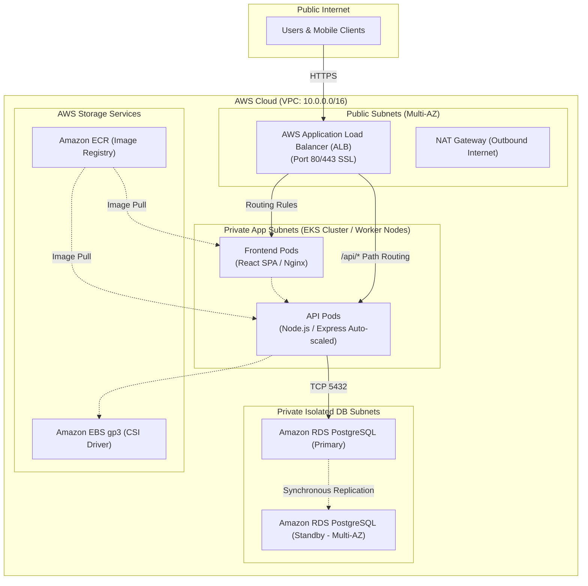

# Cloud Architecture Comparison: Local Orchestration (Minikube) vs Enterprise Cloud (AWS)

## 1. Executive Summary
Proposition 2 evaluates containerization and local vs. cloud orchestration. While local execution utilizes **Minikube** and **Docker Compose**, this document details the theoretical and production mapping of ContainerLab onto **Amazon Web Services (AWS)**.

---

## 2. Component Mapping Matrix

| Architectural Layer | Local Implementation (Minikube / Compose) | Enterprise AWS Cloud Equivalent | Key Cloud Advantages |
|---|---|---|---|
| **Virtual Networking** | Docker Bridge Networks (`frontend-net`, `backend-net`) | **Amazon VPC** with Public/Private Subnets & Security Groups | Multi-AZ network isolation, network ACLs, NAT Gateways |
| **Ingress / Routing** | Nginx Reverse Proxy + NodePort (30080) | **AWS Application Load Balancer (ALB)** via AWS Load Balancer Controller | SSL termination, DDoS protection (AWS Shield), path routing |
| **Stateless Compute** | Kubernetes Deployments (`api`, `frontend`) | **Amazon EKS Managed Node Groups** or **AWS Fargate** | Auto-scaling (HPA + Cluster Autoscaler), serverless compute |
| **Stateful Storage** | Minikube `standard` (HostPath Provisioner) | **Amazon EBS (`gp3`) CSI Driver** or **Amazon EFS** | Snapshotting, multi-AZ replication, 99.999% availability |
| **Relational Database** | Containerized PostgreSQL Deployment + PVC | **Amazon RDS for PostgreSQL** (Managed Service) | Automated backups, multi-AZ failover, read replicas |
| **Secret Management** | Kubernetes Secret (`Opaque`) | **AWS Secrets Manager** / **AWS Systems Manager Parameter Store** | Automatic rotation, KMS encryption at rest, IAM fine-grained access |
| **Image Registry** | Local Minikube Image Store (`minikube image load`) | **Amazon Elastic Container Registry (ECR)** | Vulnerability scanning, private lifecycle policies |

---

## 3. Enterprise AWS Architecture Diagram

---

## 4. Key Differences: Local Minikube vs Cloud EKS

### 4.1 Node Availability & Fault Tolerance
- **Minikube**: Operates as a single-node cluster on a single physical host. If the machine or Docker daemon fails, the entire cluster halts.
- **AWS EKS**: Runs across multiple Availability Zones (AZs). Worker nodes are provisioned in an **Auto Scaling Group (ASG)**. If an entire data center goes dark, Kubernetes reschedules pods to surviving worker nodes in other AZs within seconds.

### 4.2 Storage Durability
- **Minikube HostPath**: Storage is tied directly to the local filesystem inside the Minikube virtual machine.
- **AWS EBS / EFS**: Decoupled from the compute instance. An EBS volume survives the termination of the EC2 instance running the pod and can be detached and re-attached dynamically across the AZ.

### 4.3 Database Management
- **In-Cluster Container (ContainerLab)**: Requires manual backups, volume management, and custom restart strategies (`Recreate`).
- **Amazon RDS**: Fully managed DBaaS with point-in-time recovery, automated patching, hardware provisioning, and automated Multi-AZ synchronous replication.

---

## 5. Alternative Cloud Orchestration: Amazon ECS (Elastic Container Service) & AWS Fargate

Proposition 2 explicitly references **ECS** as an alternative container orchestrator. Below is the mapping between Kubernetes primitives and their AWS ECS/Fargate equivalents:

| Kubernetes Concept (Minikube) | Amazon ECS Equivalent | AWS Fargate Serverless Mode | Architectural Role in ContainerLab |
|---|---|---|---|
| **Pod / Pod Template** | **ECS Task Definition** | Serverless Task Definition | Declares container images (`containerlab-api`), environment variables, CPU shares (e.g., 256 units = 0.25 vCPU), and memory limits (512 MiB). |
| **Deployment (Replicas)** | **ECS Service** | ECS Service (Fargate Launch Type) | Enforces desired task count (e.g., 2 replicas), performs rolling replacement updates, and integrates directly with ALB Target Groups. |
| **ClusterIP / NodePort Service** | **ECS Service Discovery (AWS Cloud Map)** / **ALB Target Group** | Application Load Balancer Target Group | Distributes incoming HTTP requests to task private IP addresses (awsvpc network mode) without static host port bindings. |
| **ConfigMap & Secret** | **AWS Systems Manager Parameter Store** & **AWS Secrets Manager** | Parameter Store / Secrets Manager | Environment variables and database credentials injected via `secrets` and `environment` blocks in the Task Definition. |
| **PersistentVolumeClaim** | **Amazon RDS for PostgreSQL** *(recommended for managed relational DB)* or **Amazon EFS** *(for generic persistent filesystem storage)* | RDS via Fargate / EFS via Fargate Mount | **RDS is the recommended cloud equivalent for PostgreSQL**: fully managed, with automated backups, Multi-AZ failover, and no manual volume management. EFS maps to the PVC concept for filesystem workloads only and requires explicit IAM permissions and mount target setup — it is not a drop-in database replacement. |
| **Worker Node Management** | **ECS EC2 Container Instances** (Auto Scaling Group) | **AWS Fargate (No nodes to manage)** | Serverless execution: AWS abstracts and manages the underlying OS kernel, EC2 instances, and container runtime entirely. |

### Architectural Trade-Off: Kubernetes (EKS) vs Amazon ECS
- **Amazon ECS**: Simpler mental model, deeply integrated with AWS-native IAM, CloudWatch, and ALB; lower operational overhead, ideal for teams standardized on AWS.
- **Kubernetes (EKS)**: Cloud-agnostic declarative API, portable across on-premise and multi-cloud environments (Minikube ↔ EKS ↔ GKE ↔ AKS), richer ecosystem (Operators, Helm, CRDs), but requires managing Kubernetes control-plane complexity.
